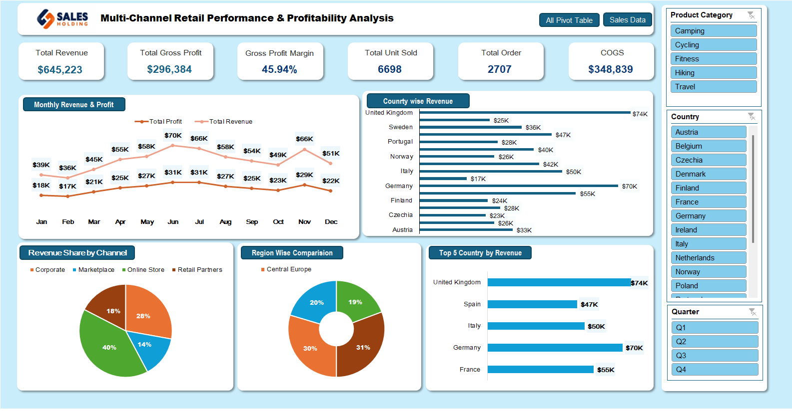

# Multi-Channel Retail Performance & Profitability Analysis

## Executive Summary
This project presents an end-to-end sales performance and profitability analysis for a European outdoor gear retail business. Utilizing Microsoft Excel, raw order data was cleaned, structured, and analyzed to evaluate top-line revenue growth, gross margins, regional market share, and channel efficiency.

---

## Interactive Dashboard Preview

---

## Business Questions Addressed
* What are the primary drivers of total revenue and gross profit margin?
* Which European regions and countries contribute the highest revenue share?
* How do sales channels compare in terms of overall revenue distribution?
* What are the month-over-month revenue and profitability trends?

---

## Key Highlights & Performance Metrics
* **Total Revenue Generated:** $645.2K across 2,707 total orders
* **Gross Profitability:** $296.4K Total Gross Profit with a **45.94% Gross Profit Margin**
* **Top Geographic Markets:** United Kingdom ($74K), Germany ($70K), and France ($55K) led total sales
* **Product Coverage:** Multi-category analysis covering Camping, Cycling, Fitness, Hiking, and Travel lines
* **Sales Channel Breakdown:** Analyzed performance across Online Store (40%), Corporate (28%), Retail Partners (18%), and Marketplace (14%)

---

## Strategic Business Insights & Recommendations
* **Core Market Dominance:** The UK, Germany, and France generate over 30% of total revenue. Focus marketing campaigns and localized promotions in these high-converting regions to maximize ROI.
* **Digital-First Channel Strategy:** Online Store drives 40% of total revenue while maintaining healthy gross margins. Expanding online marketing and loyalty programs can further accelerate growth.
* **Corporate Channel Optimization:** Corporate B2B sales yield a high average order value. Tailoring targeted B2B packages can help capture more enterprise accounts.
* **Seasonal Sales Alignment:** Peak sales align with outdoor seasonal demand. Inventory planning should be optimized 1–2 months prior to peak quarters to avoid stockouts.

---

## Technical & Data Analytics Methodologies
* **Data Cleaning & Transformation:** Formatted raw sales transactional data, validated data types, and generated date hierarchies.
* **Calculated Key Metrics:** Applied custom Excel formulas to compute Cost of Goods Sold (COGS), Gross Profit, and Margin percentages.
* **Data Summarization:** Built dynamic Pivot Tables for multi-dimensional aggregation across geographies, channels, and timelines.
* **Executive Visualization:** Designed a clean, interactive dashboard utilizing KPI summary cards, line/bar/pie charts, and multi-select Slicers (Category, Country, Quarter).

---

## Repository File Structure
* `Multi_Channel_Retail_Analysis.xlsx` — Master Excel workbook containing raw data, calculations, pivot tables, and dashboard.
* `Dashboard_Preview.png` — High-resolution preview of the executive dashboard layout.
* `Pivot_Table_Structure.jpeg` — High-resolution screenshot of underlying pivot table architecture.
